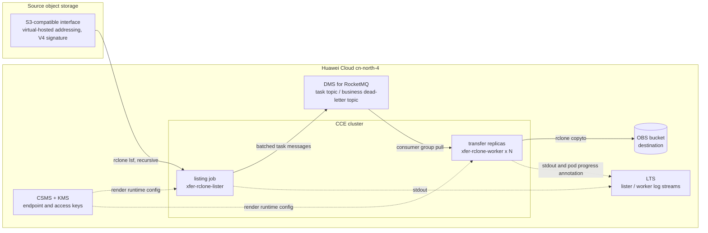

# Distributed Cross-Region Object Storage Transfer on Huawei Cloud

[](LICENSE)
[](https://www.huaweicloud.com)

## Introduction

This practice moves large volumes of object data into Huawei Cloud Object Storage Service (OBS) using a distributed, resumable and idempotent job pipeline. The source side only needs to expose an S3-compatible object storage interface: a service domain name, an access key ID and a secret access key are enough to read the object listing and the object payloads through virtual-hosted addressing. The destination is always the regional OBS endpoint `obs.<region>.myhuaweicloud.com`.

The pipeline has three stages: a listing stage, a task queue and a transfer stage.

- **Listing stage** — a one-shot Kubernetes Job walks the source bucket recursively, slices the key list into groups of `BATCH_SIZE` objects and publishes `source bucket / destination bucket / key list` records to a task topic.
- **Task queue** — Huawei Cloud Distributed Message Service for RocketMQ performs the distribution, redelivery and dead-letter isolation.
- **Transfer stage** — a workload with a fixed replica count consumes the task records under one consumer group and copies every object into OBS with rclone.

Typical users are platform or data teams that need to land buckets of hundreds of thousands of objects, ranging from a few GB to several TB, into OBS, and who want to split the work by key prefix and re-run any slice safely. Basic familiarity with Terraform and `kubectl` is enough.

## Table of Contents

- [Introduction](#introduction)
- [Architecture Overview](#architecture-overview)
- [Highlights](#highlights)
- [Huawei Cloud Services Used](#huawei-cloud-services-used)
- [Prerequisites](#prerequisites)
- [Quick Start](#quick-start)
- [Step-by-Step Deployment](#step-by-step-deployment)
- [Usage and Validation](#usage-and-validation)
- [Cleaning Up Resources](#cleaning-up-resources)
- [Reference Details](#reference-details)
- [Troubleshooting](#troubleshooting)
- [License](#license)
- [Contact](#contact)

## Architecture Overview



The listing node pool and the transfer node pool are scheduled separately through the node labels `role=lister` and `role=transfer`, so walking the key list never competes with copy bandwidth. Replicas reach the source storage over the internet through NAT gateway SNAT rules; no inbound port is opened anywhere. Component responsibilities and the failure taxonomy are described in [docs/architecture.md](docs/architecture.md) (Chinese).

## Highlights

| Highlight | Description |
|-|-|
| Three-stage decoupling | Listing, distribution and copying progress independently; a key list of hundreds of millions of objects is streamed, never held in memory |
| Resumable and idempotent | Every message carries both bucket names and its own key list; each copy command runs with `--update`, so a re-run only fills the gaps and one batch is never published twice |
| Layered failure handling | A batch is acked only when all of its objects succeeded; any failure returns the batch for redelivery up to `retry_max_times`, after which the queue parks it in `%DLQ%<consumer group>`; structurally invalid messages go straight to the business dead-letter topic |
| Hard-coded access parameters | Endpoint, virtual-hosted addressing and V4 signature are rendered in one place and re-checked statically by `check_rclone_conf.py`; a wrong value fails at render time |
| Credentials live in memory only | The runtime configuration file is written to a memory-backed volume with mode 0600 and disappears with the Pod; repository files and rendered products contain placeholders only |
| Predictable throughput | Upper bound = replicas x processes per replica x egress bandwidth, all three fixed, so scaling out means raising `worker_replicas` and re-submitting |
| Three observation channels | The listing `SUMMARY` line, the per-Pod progress annotation and the `METRIC` lines in stdout corroborate each other and are all collected by LTS |
| Everything as code | Network, OBS, RocketMQ, CCE, SWR, KMS, CSMS and LTS are declared in `infra/` and released with one command |

## Huawei Cloud Services Used

All services below are declared under `infra/` and deployed in the `cn-north-4` region.

| Huawei Cloud service | Role in this practice | Declared in |
|-|-|-|
| Object Storage Service (OBS) | Private, server-side-encrypted destination bucket with an HTTPS-only bucket policy | `infra/obs.tf` |
| Distributed Message Service for RocketMQ | Task distribution: task topic, business dead-letter topic, worker consumer group and redelivery ceiling | `infra/rocketmq.tf` |
| Cloud Container Engine (CCE) | Cluster, one listing node pool, one transfer node pool, the `transfer` namespace | `infra/cce.tf` |
| Software Repository for Container Image (SWR) | Private repositories holding the listing and transfer images | `infra/swr.tf` |
| Key Management Service (KMS) | Three keys protecting credentials, bucket object content and the transfer node data volume | `infra/secrets.tf` |
| Cloud Secret Management Service (CSMS) | Source endpoint plus access keys on both sides; needs a one-time agency grant | `infra/secrets.tf` |
| Log Tank Service (LTS) | Log group, two log streams and two CCE stdout collection rules; throughput metrics are emitted as stdout key-value lines and aggregated on the log side | `infra/lts.tf` |
| Virtual Private Cloud (VPC) | VPC, three per-AZ node subnets, an egress-only security group | `infra/network.tf` |
| Elastic IP (EIP) | Public egress address and its bandwidth, which caps end-to-end throughput | `infra/network.tf` |
| NAT Gateway | SNAT rules over all three subnets so replicas can reach the external source storage | `infra/network.tf` |
| Elastic Cloud Server (ECS) | Nodes created by the CCE node pools | `infra/cce.tf` |
| Elastic Volume Service (EVS) | Node system disks and the transfer node buffer data volume | `infra/cce.tf` |
| Identity and Access Management (IAM) | Delegation agency `xfer-rclone-cce-agency` granting OBS, SWR and CCE access to nodes | `infra/cce.tf` |
| Image Service (IMS) | Public node image selected by an anchored name expression when pinned | `infra/cce.tf` |

## Prerequisites

**Account and permissions**

- A Huawei Cloud account with a completed real-name registration and create/read permissions for OBS, DMS for RocketMQ, CCE, SWR, KMS, CSMS, LTS, VPC, EIP, NAT and IAM in `cn-north-4`.
- On first use of CSMS the `huaweicloud_csms_agency.dew` resource creates the account-level service agency; comment it out if the agency already exists.
- Nodes receive their OBS and SWR permissions through the CCE delegation agency with service type `op_svc_cce` and roles `OBS OperateAccess`, `SWR Admin` and `CCE Admin`.

**Local tooling**

- Terraform `>= 1.5` with the huaweicloud provider `~> 1.96` (see `infra/versions.tf`).
- `kubectl` and `bash`. Cluster access comes from either an existing `KUBECONFIG` or `CLUSTER_ID` combined with the Cloud Shell command `hw cce get-credentials`.
- Python 3 for manifest rendering, static checks and the offline self-test. The component images ship Python 3.12, so keeping the local interpreter on the same major and minor version is the safest choice.
- Docker or Podman plus network access to the base image registry, the rclone download site and the RocketMQ open-source client sources. Set `WITH_ROCKETMQ=false` when those sources are unreachable; the image still builds and the coordinator reports a clear error when it tries to reach the queue.

**Values to collect beforehand**

- Source service domain name, source access key ID and secret access key, the source bucket name and an optional key prefix.
- Destination bucket name: the default `xfer-rclone-dest-please-rename` is a globally used placeholder and must be replaced, otherwise `render_manifests.py` refuses to produce manifests.
- Exactly one of `node_password` or `node_key_pair`.
- Get your access keys from the **My Credentials** page of the Huawei Cloud console. Supply them to Terraform on the command line through `HW_ACCESS_KEY` and `HW_SECRET_KEY` before running it, and let the submit script write the runtime credentials of both sides into Kubernetes Secret objects. Never place real keys in repository files or commits.

**Region constraints**

- Written for `cn-north-4` with availability zones `cn-north-4a`, `cn-north-4b` and `cn-north-4c`; `subnet_cidrs` and `availability_zones` must have the same length.
- The RocketMQ instance is reachable inside the VPC only (`enable_publicip = false`) and sits in the same subnet as the transfer node pool.

## Quick Start

```bash
# 1. Provision the infrastructure
cd infra
cp terraform.tfvars.example terraform.tfvars   # change at least dest_bucket_name and the node login
terraform init
terraform apply -var-file=terraform.tfvars

# 2. Build and push the two component images
cd ..
export SWR_USERNAME='<domain>@<organization>' SWR_PASSWORD='<console login command password>'
bash src/docker/build-and-push.sh

# 3. Submit one transfer job (values come from terraform outputs)
export SRC_BUCKET='<source bucket>' DST_BUCKET='<destination bucket>' PREFIX='<key prefix, optional>'
export ROCKETMQ_NAMESRV='<name server address>' LISTER_IMAGE='<listing image>' WORKER_IMAGE='<worker image>'
export SRC_ENDPOINT='<source endpoint>' SRC_ACCESS_KEY='<AK>' SRC_SECRET_KEY='<SK>'
export HW_ACCESS_KEY='<HW_ACCESS_KEY>' HW_SECRET_KEY='<HW_SECRET_KEY>'
bash src/jobs/submit_transfer_job.sh

# 4. Watch progress
bash src/jobs/status_transfer_job.sh
```

**Offline self-test before any deployment** (never touches a remote service):

```bash
cd src/jobs && python3 selftest.py
```

The last line reads:

```
自检全部通过：配置三项访问参数、切批、确认与重投、死信转发均符合预期（全程未连接远端服务）
```

## Step-by-Step Deployment

`docs/deployment-guide.md` (Chinese) carries every command with its expected output. The main line:

**1. Provision the infrastructure.** Edit `infra/terraform.tfvars`, then run `terraform init`, `terraform validate` (`Success! The configuration is valid.`) and `terraform apply -var-file=terraform.tfvars`. The apply ends with 39 managed resources and 28 outputs. `terraform output submit_job_command` prints one line that already matches the environment the submit script expects. Afterwards fill the five CSMS credential names listed by `terraform output credential_names` with real values in the CSMS console.

**2. Build and push both images.** `bash src/docker/build-and-push.sh` logs in, builds the `lister` and `worker` build targets from `src/docker/Dockerfile` and pushes them; the produced references equal `terraform output lister_image` and `worker_image`, formatted as `<swr login server>/<name_prefix>/<repository>:<image_tag>`. The build runs the offline self-test as a build step.

**3. Render configuration and manifests.** Export `HW_REGION`, `NAME_PREFIX`, `IMAGE_TAG`, `SRC_BUCKET`, `DST_BUCKET` and `ROCKETMQ_NAMESRV`, then `python3 src/jobs/render_manifests.py --check-only` (`模板校验通过：5 份清单的占位符全部可注入`) and `python3 src/jobs/render_manifests.py --out .rendered`. Confirm the rendered access parameters with `python3 src/jobs/check_rclone_conf.py --file .rendered/rclone.conf --mode sample --region cn-north-4`.

**4. Submit the job.** Export the image references, the topic and consumer group names, the OBS endpoint, both sides of the credentials and the SWR pull identity, then `bash src/jobs/submit_transfer_job.sh`. Eight steps are printed, from `[1/8] 前置检查` to `[8/8] 汇总报告`: preflight, render, offline checks, apply namespace/RBAC/ConfigMap, write five credential objects plus the image pull Secret, roll out `xfer-rclone-worker` and publish `xfer-rclone-lister`, wait for the listing job, print the report.

**5. Check progress.** `bash src/jobs/status_transfer_job.sh`, or with `--watch` and `WATCH_INTERVAL`. Six sections are printed and the last one reads the topic, consumer group, both dead-letter topics and the redelivery ceiling straight from the ConfigMap `xfer-rclone-transfer-config`.

**6. Release resources.** Delete the job, the deployment, the credential objects and the ConfigMap in the `transfer` namespace, then `terraform destroy -var-file=terraform.tfvars` inside `infra`.

## Usage and Validation

**Smallest job.** Prove the whole chain with a narrow prefix before widening the scope:

```bash
export PREFIX='data/2024/'   # empty means the whole bucket
export BATCH_SIZE=20 WORKER_REPLICAS=1
bash src/jobs/submit_transfer_job.sh
```

**Check 1: the listing stage sliced and published.**

```bash
kubectl logs job/xfer-rclone-lister -n transfer | tail -3
```

```
INFO [lister] 已投递消息 #3（本批 5 个对象，标识 7f0c…）
INFO [lister] SUMMARY component=lister source_bucket=<source bucket> dest_bucket=<destination bucket> prefix='data/2024/' keys_total=45 messages_total=3
```

`messages_total` must equal `keys_total` divided by `BATCH_SIZE`, rounded up.

**Check 2: the transfer stage consumed everything.**

```bash
bash src/jobs/status_transfer_job.sh
```

The progress section aggregates the per-Pod annotations:

```
合计：已确认批次 3，成功对象 45，失败对象 0，待重试批次 0
```

and the metric section aggregates lines such as `1 METRIC name=batch_duration_seconds value=12.4`.

**Check 3: destination data is complete.** Run `rclone size "dest:<destination bucket>/<prefix>"` against the same configuration, or read the object count and total size in the OBS console. With `VERIFY_CHECKSUM=true` rclone compares checksums instead of size and timestamp, which is the stricter check.

**Static checks available without a cluster** (all offline):

```bash
cd src/jobs && python3 selftest.py                       # 26 assertions
python3 src/jobs/render_manifests.py --check-only        # templates and values
python3 src/jobs/check_rclone_conf.py --file <config> --mode sample --region cn-north-4
```

> These commands prove only that rendering and the coordinator logic behave correctly. After deployment, walk through every check in this section against the real environment and confirm listing, consumption and destination data all match expectations before treating the delivery as complete.

## Cleaning Up Resources

```bash
kubectl delete job xfer-rclone-lister -n transfer
kubectl delete deployment xfer-rclone-worker -n transfer
kubectl delete configmap xfer-rclone-transfer-config -n transfer
kubectl delete secret xfer-rclone-source-endpoint xfer-rclone-source-access-key \
  xfer-rclone-source-secret-key xfer-rclone-dest-access-key xfer-rclone-dest-secret-key \
  xfer-rclone-swr-pull -n transfer
cd infra && terraform destroy -var-file=terraform.tfvars
```

Release resources promptly so nothing is left behind. Two ordering notes: SWR repositories must be removed before their organization (`terraform destroy -target=huaweicloud_swr_repository.lister -target=huaweicloud_swr_repository.worker` first), and the destination bucket refuses destruction while it still holds objects because `force_destroy_bucket` defaults to `false`. CSMS secrets and KMS keys enter a seven-day pending deletion window that can be cancelled. Remove the local `.rendered/` products and any fetched `kubeconfig.yaml` yourself.

## Reference Details

**Repository layout**

```
.
├── README.md
├── README.en.md
├── LICENSE
├── docs/
│   ├── architecture.md
│   └── deployment-guide.md
├── infra/
│   ├── versions.tf                 Terraform and provider versions, region, key handling
│   ├── variables.tf                every input plus pre-deploy validation
│   ├── terraform.tfvars.example    sample values, copy to terraform.tfvars
│   ├── network.tf                  VPC, subnets, security group, EIP, NAT
│   ├── obs.tf                      destination bucket and HTTPS-only policy
│   ├── rocketmq.tf                 instance, task topic, dead-letter topic, consumer group
│   ├── cce.tf                      cluster, two node pools, namespace, node agency
│   ├── swr.tf                      organization and two private repositories
│   ├── secrets.tf                  KMS keys and CSMS placeholder credentials
│   ├── lts.tf                      log group, two streams, stdout collection rules
│   └── outputs.tf                  outputs plus submit_job_command
└── src/
    ├── docker/
    │   ├── Dockerfile              multi-stage build for both components
    │   └── build-and-push.sh       login, two build targets, push
    ├── jobs/
    │   ├── selftest.py             offline assertions, no network
    │   ├── render_manifests.py     template rendering and value validation
    │   ├── check_rclone_conf.py    endpoint, addressing and signature checks
    │   ├── submit_transfer_job.sh  eight-step submit
    │   ├── status_transfer_job.sh  progress snapshot and --watch loop
    │   └── coordinator/
    │       ├── lister_producer.py      streaming listing and batching
    │       ├── worker_consumer.py      batch consumption and copying
    │       ├── worker_entrypoint.sh    config render plus parallel processes
    │       ├── queue_client.py         queue access plus a local file backend
    │       ├── render_rclone_conf.py   runtime configuration writer
    │       ├── progress_report.py      Pod annotation progress writer
    │       └── transfer_common.py      shared parameters, validation, metrics
    └── manifests/
        ├── 00-namespace.yaml       namespace transfer
        ├── 10-rbac.yaml            three service accounts with least privilege
        ├── 20-transfer-config.yaml non-sensitive runtime parameters
        ├── 30-lister-job.yaml      listing job
        └── 40-worker-deployment.yaml transfer replicas
```

**Deployment variables.** Authoritative descriptions are in `infra/variables.tf` and `infra/terraform.tfvars.example`.

| Variable | Type | Default | Required | Meaning |
|-|-|-|-|-|
| `region` | string | `cn-north-4` | no | Deployment region |
| `name_prefix` | string | `xfer-rclone` | no | Resource name prefix; also the SWR organization name, unique per account |
| `vpc_cidr` | string | `10.0.0.0/16` | no | VPC CIDR |
| `subnet_cidrs` | list(string) | three `/24` | no | Must align one-to-one with `availability_zones` |
| `availability_zones` | list(string) | `cn-north-4a/b/c` | no | Three availability zones |
| `nat_spec` | string | `1` | no | NAT gateway specification, `1` to `4` |
| `nat_eip_bandwidth_size` | number | `100` | no | Egress bandwidth ceiling in Mbit/s |
| `dest_bucket_name` | string | `xfer-rclone-dest-please-rename` | yes | Globally unique destination bucket name, must be changed |
| `force_destroy_bucket` | bool | `false` | no | Empty the bucket on destruction; use only for a throwaway bucket |
| `rocketmq_engine_version` | string | `4.8.0` | no | Queue engine version |
| `rocketmq_flavor_id` | string | `c6.4u8g.cluster` | no | Queue instance specification, stated explicitly |
| `rocketmq_storage_spec_code` | string | `dms.physical.storage.high.v2` | no | Queue storage I/O specification |
| `rocketmq_broker_num` | number | `1` | no | Number of brokers |
| `rocketmq_storage_space` | number | `300` | no | Message storage per broker, in GB |
| `retry_max_times` | number | `2` | no | Redelivery ceiling per batch before the native dead-letter topic |
| `cce_control_flavor` | string | `cce.s1.small` | no | Cluster control plane specification |
| `cce_cluster_version` | string | `""` | no | Empty lets the platform choose a creatable version |
| `container_network_cidr` | string | `172.16.0.0/16` | no | Container network CIDR, must not overlap `vpc_cidr` |
| `service_network_cidr` | string | `10.254.0.0/16` | no | Service CIDR, must not overlap the other two |
| `lister_node_flavor` | string | `c7.large.2` | no | Listing node: 2 vCPU, 4 GiB |
| `worker_node_flavor` | string | `m7.xlarge.8` | no | Transfer node: memory-optimized 4 vCPU, 32 GiB, high network baseline |
| `node_os` | string | `Ubuntu 22.04` | no | Node operating system, must match the cluster version |
| `node_root_volume_size` | number | `50` | no | System disk size in GB |
| `node_root_volume_type` | string | `SSD` | no | Disk type |
| `worker_node_data_volume_size` | number | `100` | no | Transfer node data volume in GB, used as the rclone chunk buffer |
| `node_password` | string | `""` | one of two | Node login password |
| `node_key_pair` | string | `""` | one of two | Existing SSH key pair name |
| `use_pinned_node_image` | bool | `false` | no | Pin the node image through a name expression |
| `node_image_name_regex` | string | `^Ubuntu 22.04 server 64bit$` | no | Anchored expression; avoids GPU variants |
| `worker_replicas` | number | `1` | no | Fixed replica count, never auto-scaled on backlog |
| `worker_processes_per_replica` | number | `6` | no | Parallel rclone processes inside one replica |
| `batch_size` | number | `20` | no | Objects carried by one task message |
| `rclone_chunk_size` | string | `200M` | no | rclone chunk size |
| `swr_lister_image` | string | `lister` | no | Listing repository path |
| `swr_worker_image` | string | `worker` | no | Transfer repository path |
| `image_tag` | string | `v1` | no | Component image tag |
| `log_retention_days` | number | `7` | no | Log retention in days |

**Runtime keys** are the keys of ConfigMap `xfer-rclone-transfer-config`: region and endpoint (`HW_REGION`, `OBS_ENDPOINT`), the three pinned access values (`OBS_PROVIDER=HuaweiOBS`, `OBS_FORCE_PATH_STYLE=false`, `OBS_SIGN_ALGORITHM=v4`), `OBS_NO_CHECK_BUCKET` and `SRC_PROVIDER=Other` for the S3-compatible source, the job triple `SRC_BUCKET` / `DST_BUCKET` / `PREFIX`, the queue names `ROCKETMQ_NAMESRV` / `TASK_TOPIC` / `CONSUMER_GROUP` / `DEAD_LETTER_TOPIC` / `NATIVE_DEAD_LETTER_TOPIC` / `RETRY_MAX_TIMES`, the job shape `WORKER_REPLICAS` / `WORKER_PROCESSES_PER_REPLICA` / `BATCH_SIZE`, the rclone family `RCLONE_*`, `VERIFY_CHECKSUM`, the buffer capacity `WORKER_BUFFER_SIZE_LIMIT` and the observation keys `LOG_LEVEL`, `METRICS_TO_STDOUT`, `PROGRESS_REPORT_INTERVAL_SECONDS`.

**Credentials.** Terraform consumes `HW_ACCESS_KEY` and `HW_SECRET_KEY` from the command line. In the cluster: `xfer-rclone-source-endpoint` with key `endpoint`, `xfer-rclone-source-access-key` and `xfer-rclone-dest-access-key` with key `access_key`, `xfer-rclone-source-secret-key` and `xfer-rclone-dest-secret-key` with key `secret_key`, plus the docker-registry Secret `xfer-rclone-swr-pull`. Static access keys are used on both sides; no temporary instance identity is involved. Real values exist only in the submitting process and in the cluster Secrets, and the rendered configuration file lands on a memory volume with mode 0600 that is destroyed with the Pod. When a credential is missing or still a placeholder, the submit script skips creation and reuses the existing object rather than overwriting real values.

## Troubleshooting

**`render_manifests.py` exits with `参数校验不通过：目的端桶名仍是占位默认值`.** Change `dest_bucket_name`, re-apply, and submit with the new `DST_BUCKET`.

**The submit script stops at `[1/8] 前置检查`.** Provide `SRC_BUCKET`, `DST_BUCKET`, `ROCKETMQ_NAMESRV`, `LISTER_IMAGE` and `WORKER_IMAGE`; `terraform output submit_job_command` reproduces the whole line.

**Replicas stay stuck while pulling the image.** Both repositories are private, so a missing pull Secret returns 401. Export `SWR_USERNAME` and `SWR_PASSWORD` and re-run the submit script, or verify that `xfer-rclone-swr-pull` exists in the `transfer` namespace.

**A replica logs `无法加载消息队列客户端`.** The image must be built from `src/docker/Dockerfile` with the native runtime library; images built with `WITH_ROCKETMQ=false` start but fail with exactly this message when connecting.

**No progress annotation on the Pod.** The section prints `尚无进度（副本刚启动或进度回写被拒）`. Writing back needs `get`, `patch` and `update` on `pods` for service account `transfer-worker` (see `src/manifests/10-rbac.yaml`). A rejected write only logs a warning and never changes the transfer outcome, so fall back to the `SUMMARY` and `METRIC` lines.

**Some objects stop being retried.** After `retry_max_times` the queue delivers the batch to `%DLQ%xfer-rclone-worker-group` for manual handling; structurally invalid messages never enter that path and land in `xfer-rclone-transfer-dlq` with `reject_reasons`.

**The destination rejects the write.** Addressing and signing are fixed to virtual-hosted style and V4. Setting `OBS_FORCE_PATH_STYLE` to anything other than `false`, or `OBS_SIGN_ALGORITHM` to a lower signature version, fails during rendering; `check_rclone_conf.py --mode runtime` blocks the same configuration before a replica consumes anything.

**Listing a whole bucket is slow.** Split the work by `PREFIX` and submit several rounds; the listing stage streams the key list and never loads it entirely. Raise `worker_replicas` for more throughput and, if that saturates, `nat_eip_bandwidth_size`.

## License

This practice is released under the MIT No Attribution license; see [LICENSE](LICENSE).

## Contact

Maintained by the Public Cloud Continuous Operations Department.
