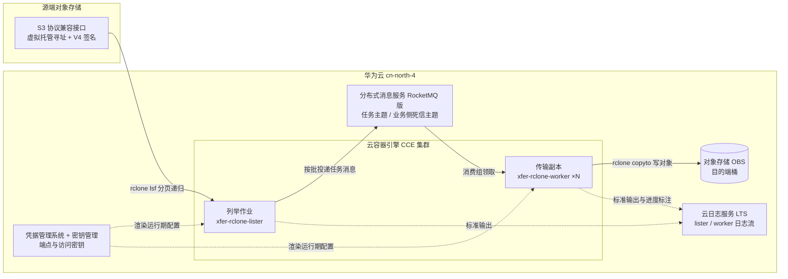

# 跨云对象存储分布式搬运实践（华为云）

[](LICENSE)
[](https://www.huaweicloud.com)

## 简介

本实践演示如何把大量存放在对象存储里的历史数据，以分布式、可断点续传、可重跑的方式搬运到华为云对象存储服务 OBS。

源端只要求提供兼容 S3 协议的对象存储访问接口：给出服务域名、访问密钥 ID 与私密访问密钥，即可按虚拟托管寻址方式读取对象清单与对象内容。目的端固定为 OBS 的区域服务端点 `obs.<region>.myhuaweicloud.com`。

整体形态是「列举侧 → 消息队列 → 传输侧」三段式：

- **列举侧**：一个一次性作业分页递归读取源端对象清单，按 `BATCH_SIZE` 切批，把「源端桶 / 目的端桶 / 一批对象键」投递到任务主题；
- **消息队列**：华为云分布式消息服务 RocketMQ 版承担任务分发、失败重投与死信隔离；
- **传输侧**：固定副本数的工作负载以同一消费组领取任务消息，逐对象调用搬运工具 rclone 写入 OBS。

适用于需要把 GB 到 TB 级、对象数达十万以上的存储桶批量落到 OBS 的场景，也适用于按前缀分批、多次续传的运维同学。使用者只需掌握 Terraform 与 `kubectl` 的基本用法。

## 目录

- [简介](#简介)
- [架构总览](#架构总览)
- [方案亮点](#方案亮点)
- [涉及云服务](#涉及云服务)
- [前置条件](#前置条件)
- [快速开始](#快速开始)
- [分步部署](#分步部署)
- [使用方法与验证](#使用方法与验证)
- [清理资源](#清理资源)
- [详细说明](#详细说明)
- [常见问题与排查](#常见问题与排查)
- [许可证](#许可证)
- [联系方式](#联系方式)

## 架构总览



列举节点池与传输节点池分开调度（节点标签 `role=lister` / `role=transfer`），列举动作不抢占传输带宽。传输副本经 NAT 网关的 SNAT 规则统一出网访问源端，集群侧不开放任何入方向端口。更完整的组件职责与数据流见 [docs/architecture.md](docs/architecture.md)。

## 方案亮点

| 亮点 | 说明 |
|-|-|
| 三段式解耦 | 列举、分发、搬运互不阻塞，清单规模可达亿级对象而不整体驻留内存 |
| 断点与幂等 | 消息体自带源端桶、目的端桶与对象键；单个对象复制命令带 `--update`，重跑只补缺失对象，同一批不重复投递 |
| 失败分层处理 | 整批任一对象失败即交回队列按 `retry_max_times` 重投；达到上限后进入原生死信主题 `%DLQ%<消费组名>`；结构非法消息直接转业务侧死信主题，不占用重试通道 |
| 访问参数固化 | 端点、虚拟托管寻址、V4 签名三项参数由协调层集中渲染并被 `check_rclone_conf.py` 静态核对，取错值在渲染阶段直接失败 |
| 凭据只落内存 | 运行期配置写在 `emptyDir{medium: Memory}`，权限 0600，随 Pod 生命周期销毁；仓库文件与渲染产物里只有占位符 |
| 吞吐可预估 | 端到端吞吐上限 = 副本数 × 每副本并行进程数 × 出网带宽，三项均为固定值，扩容只需调大 `worker_replicas` 后重新提交 |
| 观测三条线索 | 列举作业 `SUMMARY` 行、每副本 Pod 进度标注、标准输出 `METRIC` 指标行互相印证，均由 LTS 采集 |
| 基础设施即代码 | 网络、OBS、RocketMQ、CCE、SWR、KMS、凭据管理、LTS 全部由 `infra/` 声明，一条命令释放 |

## 涉及云服务

下表服务全部由 `infra/` 目录声明，部署区域为 `cn-north-4`。

| 云服务 | 本实践中的职责 | 声明位置 |
|-|-|-|
| 对象存储 OBS | 目的端存储桶，私有读、服务端加密，桶策略只允许 HTTPS 访问 | `infra/obs.tf` |
| 分布式消息服务 RocketMQ 版 | 任务分发：任务主题、业务侧死信主题、传输消费组与重投上限 | `infra/rocketmq.tf` |
| 云容器引擎 CCE | 集群、列举节点池、传输节点池、`transfer` 命名空间 | `infra/cce.tf` |
| 容器镜像服务 SWR | 存放列举组件与传输组件的私有镜像仓库 | `infra/swr.tf` |
| 密钥管理系统 KMS | 三把主密钥分别保护源端凭据、目的端桶对象、传输节点数据盘 | `infra/secrets.tf` |
| 凭据管理系统 | 保存源端域名与两端访问密钥，首次使用需建立服务委托 | `infra/secrets.tf` |
| 云日志服务 LTS | 日志组与两个日志流，采集 `transfer` 命名空间内两个组件的标准输出（吞吐指标同样以标准输出的键值行给出，由日志侧聚合） | `infra/lts.tf` |
| 虚拟私有云 VPC | 专有网络、三个可用区的节点子网、只有出方向的安全组 | `infra/network.tf` |
| 弹性公网 IP EIP | 出网公网地址与带宽，决定端到端吞吐上限 | `infra/network.tf` |
| NAT 网关 | SNAT 规则覆盖三个子网，为传输副本提供出网访问源端的能力 | `infra/network.tf` |
| 弹性云服务器 ECS | 由 CCE 节点池创建的列举节点与传输节点 | `infra/cce.tf` |
| 云硬盘 EVS | 节点系统盘与传输节点的分片缓冲数据盘 | `infra/cce.tf` |
| 统一身份认证服务 IAM | 容器引擎节点的代维委托，授予 OBS 操作、SWR 拉取、CCE 管理权限 | `infra/cce.tf` |
| 镜像服务 IMS | 需要固定节点镜像时按名称表达式选取公共镜像 | `infra/cce.tf` |

## 前置条件

**账号与权限**

- 华为云账号已完成实名认证，且在 `cn-north-4` 区域具备以下权限：OBS、DMS RocketMQ 版、CCE、SWR、KMS、凭据管理、LTS、VPC、EIP、NAT、IAM 的创建与查询权限。
- 首次使用凭据管理系统时，`infra/secrets.tf` 中的 `huaweicloud_csms_agency.dew` 会为账号建立服务委托；账号内已建立过该委托的话，注释掉该资源即可。
- 容器引擎节点通过委托 `xfer-rclone-cce-agency` 获取 OBS 与 SWR 访问权限，委托服务类型为 `op_svc_cce`。

**本地工具**

- Terraform `>= 1.5`，huaweicloud Provider `~> 1.96`（`infra/versions.tf` 声明）。
- `kubectl` 与 `bash`；集群访问凭证二选一：已有 `KUBECONFIG`，或提供 `CLUSTER_ID` 并用云命令行执行 `hw cce get-credentials` 换取。
- Python 3（组件镜像内为 3.12，本地脚本与镜像保持一致最省事），用于运行渲染脚本与离线自检。
- 构建镜像需要 Docker（或 Podman）与可访问基础镜像仓库、rclone 下载站、消息队列开源客户端源码的网络；无法访问时可用 `WITH_ROCKETMQ=false` 构建，队列侧行为会在接入时给出明确报错。

**部署前必须准备的取值**

- 源端对象存储的服务域名、访问密钥 ID、私密访问密钥，以及源端桶名与可选键前缀。
- 目的端桶名：`dest_bucket_name` 默认值 `xfer-rclone-dest-please-rename` 属全域占位名，必须改成未被占用的唯一名称，否则 `render_manifests.py` 会直接拒绝提交。
- 节点登录方式：`node_password` 与 `node_key_pair` 必须且只能提供一个。
- 访问密钥在华为云「我的凭证」页面获取。执行 Terraform 前以 `HW_ACCESS_KEY`、`HW_SECRET_KEY` 两个变量提供给命令行；作业运行期的两端凭据由提交脚本写入集群 Secret 对象。不要把任何真实密钥写进仓库文件，也不要提交到代码仓库。

**区域约束**

- 实践按 `cn-north-4` 编写，可用区取 `cn-north-4a`/`cn-north-4b`/`cn-north-4c`；`subnet_cidrs` 与 `availability_zones` 数量必须一致。
- 消息队列实例只在 VPC 内接入（`enable_publicip = false`），与传输节点池位于同一个子网可用区。

## 快速开始

```bash
# 1. 部署基础设施（部署区域内所有资源）
cd infra
cp terraform.tfvars.example terraform.tfvars   # 至少改掉 dest_bucket_name 与节点登录方式
terraform init
terraform apply -var-file=terraform.tfvars

# 2. 构建并推送两个组件镜像（需要 SWR 登录账号与口令）
cd ..
export SWR_USERNAME='<租户名>@<组织名>' SWR_PASSWORD='<控制台登录指令给出的口令>'
bash src/docker/build-and-push.sh

# 3. 提交一次搬运作业（取值来自上一步与 terraform output）
export SRC_BUCKET='<源端桶名>' DST_BUCKET='<目的端桶名>' PREFIX='<键前缀，可留空>'
export ROCKETMQ_NAMESRV='<队列接入地址>' LISTER_IMAGE='<列举镜像地址>' WORKER_IMAGE='<传输镜像地址>'
export SRC_ENDPOINT='<源端服务域名>' SRC_ACCESS_KEY='<AK>' SRC_SECRET_KEY='<SK>'
export HW_ACCESS_KEY='<HW_ACCESS_KEY>' HW_SECRET_KEY='<HW_SECRET_KEY>'
bash src/jobs/submit_transfer_job.sh

# 4. 查看进度
bash src/jobs/status_transfer_job.sh
```

**离线部署前自检**（不连接任何远端服务，可先单独执行）：

```bash
cd src/jobs && python3 selftest.py
```

预期输出末行：

```
自检全部通过：配置三项访问参数、切批、确认与重投、死信转发均符合预期（全程未连接远端服务）
```

## 分步部署

完整命令与每步预期输出见 [docs/deployment-guide.md](docs/deployment-guide.md)，此处给出主线。

### 第 1 步：建立基础设施

```bash
cd infra
cp terraform.tfvars.example terraform.tfvars
```

改 `terraform.tfvars` 中至少三处：`dest_bucket_name`、`node_password` 或 `node_key_pair`、`name_prefix`（同时作为 SWR 组织名，需账号内唯一）。

```bash
terraform init
terraform validate
terraform apply -var-file=terraform.tfvars
```

预期输出：`validate` 返回 `Success! The configuration is valid.`；`apply` 结束时打印 28 个 output，其中搬运作业必须记录的有 `rocketmq_namesrv_address`、`task_topic`、`worker_consumer_group`、`dead_letter_topic`、`native_dead_letter_topic`、`dest_bucket`、`obs_endpoint`、`cluster_id`、`namespace`、`swr_login_server`、`credential_names`。

`apply` 之后还有一条可直接照抄的启动命令：

```bash
terraform output submit_job_command
```

输出即 `SRC_BUCKET=<源端桶名> DST_BUCKET=... PREFIX=... ... bash src/jobs/submit_transfer_job.sh` 一整行，变量名与提交脚本要求的取值一一对应。

### 第 2 步：构建并推送两个镜像

```bash
cd ..
export SWR_USERNAME='<租户名>@<组织名>' SWR_PASSWORD='<控制台登录指令给出的口令>'
bash src/docker/build-and-push.sh
```

脚本按四步打印 `[1/4] 登录镜像仓库 …` 至 `[4/4] 推送两个镜像`，结束时给出 `LISTER_IMAGE` 与 `WORKER_IMAGE` 两个可直接导出的赋值行。镜像地址口径与 `terraform output lister_image` / `worker_image` 完全一致：`<swr 登录地址>/<name_prefix>/<仓库名>:<image_tag>`。

### 第 3 步：渲染配置与清单

```bash
export HW_REGION=cn-north-4 NAME_PREFIX=xfer-rclone IMAGE_TAG=v1
export SRC_BUCKET='<源端桶名>' DST_BUCKET='<目的端桶名>' ROCKETMQ_NAMESRV='<队列接入地址>'
python3 src/jobs/render_manifests.py --check-only
python3 src/jobs/render_manifests.py --out .rendered
```

第一条只校验不写文件，预期首行 `模板校验通过：5 份清单的占位符全部可注入`；第二条生成 `.rendered/` 下的 5 份清单与一份仅含占位凭据的 `rclone.conf`，随后逐行打印生效取值。取值优先级为环境变量 > 与 `infra/terraform.tfvars.example` 一致的默认值。

核对渲染出的访问参数：

```bash
python3 src/jobs/check_rclone_conf.py --file .rendered/rclone.conf --mode sample --region cn-north-4
```

预期输出 `配置核对通过：端点、寻址风格与签名方式三项均符合要求（.rendered/rclone.conf）`。

### 第 4 步：提交搬运作业

```bash
export LISTER_IMAGE='<列举镜像地址>' WORKER_IMAGE='<传输镜像地址>'
export TASK_TOPIC=xfer-rclone-transfer-task CONSUMER_GROUP=xfer-rclone-worker-group
export DEAD_LETTER_TOPIC=xfer-rclone-transfer-dlq OBS_ENDPOINT=obs.cn-north-4.myhuaweicloud.com
export SRC_ENDPOINT='<源端服务域名>' SRC_ACCESS_KEY='<AK>' SRC_SECRET_KEY='<SK>'
export HW_ACCESS_KEY='<HW_ACCESS_KEY>' HW_SECRET_KEY='<HW_SECRET_KEY>'
bash src/jobs/submit_transfer_job.sh
```

脚本分 8 步打印 `[1/8] 前置检查` 到 `[8/8] 汇总报告`：检查工具与必填取值 → 渲染清单 → 离线核对 → 应用 `00/10/20` 三份清单 → 写 5 个凭据对象与镜像拉取凭证 → 拉起 `xfer-rclone-worker` 并投递 `xfer-rclone-lister` 作业 → 跟踪列举完成 → 打印汇总。

### 第 5 步：查进度

```bash
bash src/jobs/status_transfer_job.sh          # 单次快照
bash src/jobs/status_transfer_job.sh --watch  # 每 30s 刷新，可用 WATCH_INTERVAL 覆盖
```

输出分「列举作业 / 传输副本 / 每副本进度标注 / 指标行汇总 / 最近失败线索 / 队列与死信查看线索」六节，最后一节直接从 ConfigMap `xfer-rclone-transfer-config` 读出任务主题、业务侧死信主题、消费组、原生死信主题与重投上限，照抄到消息队列控制台即可。

### 第 6 步：释放资源

```bash
kubectl delete job xfer-rclone-lister -n transfer
kubectl delete deployment xfer-rclone-worker -n transfer
cd infra && terraform destroy -var-file=terraform.tfvars
```

`terraform destroy` 会销毁全部基础设施。SWR 组织必须在其下仓库清空后才能删除，必要时先执行 `terraform destroy -target=huaweicloud_swr_repository.lister -target=huaweicloud_swr_repository.worker`。OBS 桶在 `force_destroy_bucket = false`（默认）且桶内有对象时会拒绝销毁，这是防止误删已落盘数据。

## 使用方法与验证

**最小作业**：先用一个对象数较少的前缀跑通全链路，再放大范围。

```bash
export PREFIX='data/2024/'   # 留空则整桶列举
export BATCH_SIZE=20 WORKER_REPLICAS=1
bash src/jobs/submit_transfer_job.sh
```

**验证一：列举侧是否切批投递**

```bash
kubectl logs job/xfer-rclone-lister -n transfer | tail -3
```

预期看到逐批投递行与末行汇总：

```
INFO [lister] 已投递消息 #3（本批 5 个对象，标识 7f0c…）
INFO [lister] SUMMARY component=lister source_bucket=<源端桶名> dest_bucket=<目的端桶名> prefix='data/2024/' keys_total=45 messages_total=3
```

**验证二：传输侧是否消费完成**

```bash
bash src/jobs/status_transfer_job.sh
```

预期「每副本进度标注」一节的合计行形如：

```
合计：已确认批次 3，成功对象 45，失败对象 0，待重试批次 0
```

指标行一节形如 `1 METRIC name=batch_duration_seconds value=12.4`。

**验证三：目的端数据完整性**

```bash
rclone size "dest:<目的端桶名>/<前缀>"   # 本地已配置同一份 rclone.conf 时
```

或在 OBS 控制台核对对象数与总大小；开启 `VERIFY_CHECKSUM=true` 后，搬运工具会按校验和比对而非大小与时间戳，核对结果更严格。

**部署前可做的静态校验**（全程离线）：

```bash
cd src/jobs && python3 selftest.py                       # 26 项断言，覆盖配置渲染、队列读写与投递、列举侧寻址与路径拼接
python3 src/jobs/render_manifests.py --check-only        # 模板占位符与取值一致性
python3 src/jobs/check_rclone_conf.py --file <配置文件> --mode sample --region cn-north-4
```

> 上述命令只证明渲染与协调层逻辑正确。部署完成后请按本节步骤在真实环境逐条自行验证，确认列举、消费、目的端数据三项都符合预期后，方可视为交付完成。

## 清理资源

- 结束作业：`kubectl delete job xfer-rclone-lister -n transfer`、`kubectl delete deployment xfer-rclone-worker -n transfer`。
- 删除运行参数与凭据对象：`kubectl delete configmap xfer-rclone-transfer-config -n transfer`、`kubectl delete secret xfer-rclone-source-endpoint xfer-rclone-source-access-key xfer-rclone-source-secret-key xfer-rclone-dest-access-key xfer-rclone-dest-secret-key xfer-rclone-swr-pull -n transfer`。
- 销毁基础设施：`cd infra && terraform destroy -var-file=terraform.tfvars`，及时释放资源，避免残留。
- 桶内数据若需要保留，请先确认 OBS 桶内容与 `force_destroy_bucket` 取值；销毁后凭据管理系统里的凭据与 KMS 主密钥会进入待删除期（`pending_days = 7`），期间可取消删除。
- 本地渲染产物目录 `.rendered/` 与换取到的 `kubeconfig.yaml` 用完自行删除。

## 详细说明

**目录结构**

```
.
├── README.md
├── README.en.md
├── LICENSE
├── docs/
│   ├── architecture.md
│   └── deployment-guide.md
├── infra/
│   ├── versions.tf                 # Terraform 与 Provider 版本、区域与密钥口径
│   ├── variables.tf                # 全部输入变量与部署前校验
│   ├── terraform.tfvars.example    # 参数样例，复制为 terraform.tfvars 后修改
│   ├── network.tf                  # VPC / 子网 / 安全组 / EIP / NAT
│   ├── obs.tf                      # 目的端桶与强制 HTTPS 桶策略
│   ├── rocketmq.tf                 # 队列实例、任务主题、死信主题、消费组
│   ├── cce.tf                      # 集群、两个节点池、transfer 命名空间、节点委托
│   ├── swr.tf                      # 镜像组织与两个私有仓库
│   ├── secrets.tf                  # KMS 主密钥与凭据管理占位凭据
│   ├── lts.tf                      # 日志组、两个日志流与容器标准输出采集
│   └── outputs.tf                  # 对外输出与 submit_job_command
└── src/
    ├── docker/
    │   ├── Dockerfile              # 两个组件镜像的同源多阶段构建
    │   └── build-and-push.sh       # 登录 → 构建两个 target → 推送
    ├── jobs/
    │   ├── selftest.py             # 离线自检，全程不联网
    │   ├── render_manifests.py     # 清单渲染与取值核对
    │   ├── check_rclone_conf.py    # 端点/寻址/签名三项静态核对
    │   ├── submit_transfer_job.sh  # 一键提交，8 个步骤
    │   ├── status_transfer_job.sh  # 进度快照与 --watch 刷新
    │   └── coordinator/
    │       ├── lister_producer.py      # 列举侧：分页读取 + 切批投递
    │       ├── worker_consumer.py      # 传输侧：领取批次 + 逐对象复制
    │       ├── worker_entrypoint.sh    # 副本入口：渲染配置 + 拉起并行进程
    │       ├── queue_client.py         # 队列接入层与离线文件队列
    │       ├── render_rclone_conf.py   # 运行期配置渲染
    │       ├── progress_report.py      # 进度写回 Pod 标注
    │       └── transfer_common.py      # 参数读取、配置渲染、校验、指标
    └── manifests/
        ├── 00-namespace.yaml       # 命名空间 transfer
        ├── 10-rbac.yaml            # 三个服务账号与最小权限
        ├── 20-transfer-config.yaml # 运行参数 ConfigMap（非敏感）
        ├── 30-lister-job.yaml      # 列举作业
        └── 40-worker-deployment.yaml # 传输副本
```

**部署参数**（完整取值语义见 `infra/variables.tf` 与 `infra/terraform.tfvars.example`）

| 变量 | 类型 | 默认值 | 必填 | 说明 |
|-|-|-|-|-|
| `region` | string | `cn-north-4` | 否 | 资源部署区域 |
| `name_prefix` | string | `xfer-rclone` | 否 | 资源命名前缀，同时作为 SWR 组织名，需账号内唯一 |
| `vpc_cidr` | string | `10.0.0.0/16` | 否 | 专有网络地址段 |
| `subnet_cidrs` | list(string) | 三个 `/24` | 否 | 与 `availability_zones` 顺序一一对应，数量必须一致 |
| `availability_zones` | list(string) | `cn-north-4a/b/c` | 否 | 三个可用区 |
| `nat_spec` | string | `1` | 否 | NAT 网关规格，取值 `1`/`2`/`3`/`4` |
| `nat_eip_bandwidth_size` | number | `100` | 否 | 出网带宽上限，单位 Mbit/s，决定端到端吞吐上限 |
| `dest_bucket_name` | string | `xfer-rclone-dest-please-rename` | 是 | 目的端桶名，全域唯一，必须改成未占用的名称 |
| `force_destroy_bucket` | bool | `false` | 否 | 销毁时是否自动清空桶内容，仅一次性验证用途时设为 `true` |
| `rocketmq_engine_version` | string | `4.8.0` | 否 | 队列引擎版本 |
| `rocketmq_flavor_id` | string | `c6.4u8g.cluster` | 否 | 队列实例规格，显式指定不依赖数据源顺序 |
| `rocketmq_storage_spec_code` | string | `dms.physical.storage.high.v2` | 否 | 队列存储 I/O 规格 |
| `rocketmq_broker_num` | number | `1` | 否 | Broker 数量 |
| `rocketmq_storage_space` | number | `300` | 否 | 每个 Broker 的消息存储容量，单位 GB |
| `retry_max_times` | number | `2` | 否 | 同一批对象的最大重投次数，超过后进入原生死信主题 |
| `cce_control_flavor` | string | `cce.s1.small` | 否 | 集群控制面规格 |
| `cce_cluster_version` | string | `""` | 否 | 留空由平台选择当前可创建的版本 |
| `container_network_cidr` | string | `172.16.0.0/16` | 否 | 容器网络地址段，不得与 `vpc_cidr` 重叠 |
| `service_network_cidr` | string | `10.254.0.0/16` | 否 | Service 地址段，不得与前两者重叠 |
| `lister_node_flavor` | string | `c7.large.2` | 否 | 列举节点规格，2 vCPU / 4 GiB |
| `worker_node_flavor` | string | `m7.xlarge.8` | 否 | 传输节点规格，内存优化型 4 vCPU / 32 GiB，高网络基线 |
| `node_os` | string | `Ubuntu 22.04` | 否 | 节点操作系统，需与集群版本兼容 |
| `node_root_volume_size` | number | `50` | 否 | 节点系统盘容量，单位 GB |
| `node_root_volume_type` | string | `SSD` | 否 | 节点磁盘类型 |
| `worker_node_data_volume_size` | number | `100` | 否 | 传输节点数据盘容量，单位 GB，用于 rclone 分片缓冲 |
| `node_password` | string | `""` | 二选一 | 节点登录密码，与 `node_key_pair` 只能填一个 |
| `node_key_pair` | string | `""` | 二选一 | 已存在的节点 SSH 密钥对名称 |
| `use_pinned_node_image` | bool | `false` | 否 | 是否按名称表达式固定节点镜像 |
| `node_image_name_regex` | string | `^Ubuntu 22.04 server 64bit$` | 否 | 必须首尾锚定，避免命中带显卡驱动的变体 |
| `worker_replicas` | number | `1` | 否 | 传输副本数，固定值，不随队列积压自动增减 |
| `worker_processes_per_replica` | number | `6` | 否 | 每个副本内并行的搬运进程数 |
| `batch_size` | number | `20` | 否 | 每条任务消息携带的对象数量 |
| `rclone_chunk_size` | string | `200M` | 否 | 搬运工具分片大小 |
| `swr_lister_image` | string | `lister` | 否 | 列举组件仓库路径 |
| `swr_worker_image` | string | `worker` | 否 | 传输组件仓库路径 |
| `image_tag` | string | `v1` | 否 | 组件镜像标签 |
| `log_retention_days` | number | `7` | 否 | 日志保留天数 |

**作业运行参数**（ConfigMap `xfer-rclone-transfer-config` 的键，均由渲染器写入）

| 键 | 消费方 | 说明 |
|-|-|-|
| `HW_REGION` / `OBS_ENDPOINT` | 列举、传输 | 区域与目的端区域服务端点 |
| `OBS_PROVIDER` / `OBS_FORCE_PATH_STYLE` / `OBS_SIGN_ALGORITHM` | 配置渲染 | 固定 `HuaweiOBS` / `false` / `v4`，取错值渲染阶段直接失败 |
| `OBS_NO_CHECK_BUCKET` / `SRC_PROVIDER` | 配置渲染 | 目的端不再探测桶；源端按兼容协议以 `Other` 接入 |
| `SRC_BUCKET` / `DST_BUCKET` / `PREFIX` | 列举 | 本次任务的三元组 |
| `ROCKETMQ_NAMESRV` / `TASK_TOPIC` / `CONSUMER_GROUP` / `DEAD_LETTER_TOPIC` / `NATIVE_DEAD_LETTER_TOPIC` / `RETRY_MAX_TIMES` | 队列接入 | 名称一律以 `infra/rocketmq.tf` 为准 |
| `WORKER_REPLICAS` / `WORKER_PROCESSES_PER_REPLICA` / `BATCH_SIZE` | 作业形态 | 副本数、副本内进程数、每批对象数 |
| `RCLONE_*` | 传输 | 分片大小、上传并发、缓冲、限速、重试与附加参数 |
| `VERIFY_CHECKSUM` | 传输 | 开启后按校验和比对 |
| `WORKER_BUFFER_SIZE_LIMIT` | 副本清单 | 分片缓冲容量，口径与 `worker_node_data_volume_size` 一致 |
| `LOG_LEVEL` / `METRICS_TO_STDOUT` / `PROGRESS_REPORT_INTERVAL_SECONDS` | 可观测 | 日志详细度、指标输出与进度回写间隔 |

**凭据口径**

| 名称 | 来源 | 用途 |
|-|-|-|
| `HW_ACCESS_KEY` / `HW_SECRET_KEY` | Terraform 执行前的命令行取值 | 创建与销毁华为云资源；同时是目的端 OBS 的写入身份 |
| `xfer-rclone-source-endpoint`（键 `endpoint`） | 凭据管理系统占位，提交脚本按真实值写入集群 Secret | 源端服务域名 |
| `xfer-rclone-source-access-key`（键 `access_key`）、`xfer-rclone-source-secret-key`（键 `secret_key`） | 同上 | 源端读取身份 |
| `xfer-rclone-dest-access-key`（键 `access_key`）、`xfer-rclone-dest-secret-key`（键 `secret_key`） | 同上 | 目的端 OBS 写入身份 |
| `xfer-rclone-swr-pull` | 提交脚本按 `SWR_USERNAME` / `SWR_PASSWORD` 创建 | 私有镜像仓库拉取凭证 |

两端一律使用静态访问密钥，不依赖实例元数据接口取临时身份。真实凭据只存在于命令行进程与集群 Secret 对象中，运行期渲染出的配置文件落在内存卷、权限 0600，随 Pod 销毁；`terraform output credential_names` 会列出需要提前建好的凭据名称。提交脚本在凭据缺失时不会创建凭据对象，直接使用集群里已有的对象，避免用占位内容覆盖运行中的真实值。

## 常见问题与排查

**`render_manifests.py` 报「参数校验不通过：目的端桶名仍是占位默认值」**
先改 `infra/variables.tf` 对应的 `dest_bucket_name` 并重新 `terraform apply`，再以新的 `DST_BUCKET` 提交作业。

**提交脚本停在 `[1/8] 前置检查`**
按提示补全 `SRC_BUCKET` / `DST_BUCKET` / `ROCKETMQ_NAMESRV` / `LISTER_IMAGE` / `WORKER_IMAGE`；`terraform output submit_job_command` 给出的整行可直接复用。

**副本长时间停在镜像拉取阶段**
仓库为私有，缺拉取凭证会得到 401。确认 `SWR_USERNAME` / `SWR_PASSWORD` 已导出后重跑提交脚本，或单独确认 `xfer-rclone-swr-pull` 是否存在于 `transfer` 命名空间。

**副本日志报「无法加载消息队列客户端」**
镜像需由 `src/docker/Dockerfile` 构建并保留原生运行库；用 `WITH_ROCKETMQ=false` 构建的镜像仍能启动，但接入队列时会给出该明确报错。

**Pod 标注里没有进度**
「每副本进度标注」一节会显示「尚无进度（副本刚启动或进度回写被拒）」。回写需要服务账号 `transfer-worker` 对 `pods` 的 `get/patch/update` 权限，见 `src/manifests/10-rbac.yaml`；回写失败只记日志，不影响传输结果，可退回日志与 `SUMMARY` 行判断。

**部分对象反复重试后消失**
达到 `retry_max_times` 后整批由队列投递到原生死信主题 `%DLQ%xfer-rclone-worker-group`，需要人工处理；结构非法的消息不进重试通道，直接落在业务侧死信主题 `xfer-rclone-transfer-dlq` 并带 `reject_reasons`。

**目的端拒绝访问**
协调层固定使用虚拟托管寻址与 V4 签名。若把 `OBS_FORCE_PATH_STYLE` 改为非 `false`，或把 `OBS_SIGN_ALGORITHM` 改为低版本签名，渲染阶段直接失败并给出原因；`check_rclone_conf.py --mode runtime` 也会在副本消费前拦下这类配置。

**整桶列举很慢**
用 `PREFIX` 按前缀分批提交；列举侧走流式输出，不把清单整体读进内存。吞吐不足时调大 `worker_replicas`（副本数固定，不会随积压自动扩容），必要时同步调大 `nat_eip_bandwidth_size`。

## 许可证

本实践采用 MIT No Attribution 许可证发布，全文见 [LICENSE](LICENSE)。

## 联系方式

创建与维护团队：公有云持续运营部。
