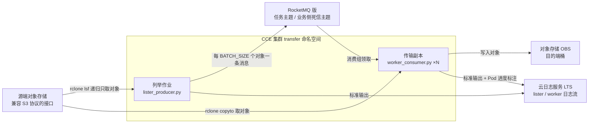
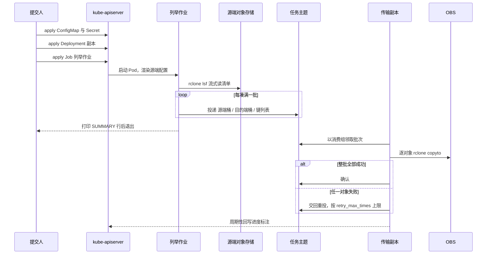

# 架构说明

本文描述本实践的组件职责、数据流、断点与幂等设计、观测与进度上报，以及若干关键设计取舍。所有结论均来自 `infra/` 与 `src/` 下的现有声明与脚本。

## 1. 组件划分

| 组件 | 运行形态 | 集群位置 | 职责 |
|-|-|-|-|
| 列举侧 `lister` | 一次性 Job，跑完退出 | `xfer-rclone-lister`，节点标签 `role=lister` | 分页递归读取源端对象清单，按批投递任务消息 |
| 消息队列 | 托管实例，仅 VPC 内接入 | 分布式消息服务 RocketMQ 版实例 `xfer-rclone-queue` | 任务分发、失败重投、死信隔离 |
| 传输侧 `worker` | 固定副本数 Deployment | `xfer-rclone-worker`，节点标签 `role=transfer` | 以消费组领取任务消息，逐对象把源端数据写入 OBS |
| 运行参数 | ConfigMap | `xfer-rclone-transfer-config` | 承载区域、端点、桶名、队列名称、搬运参数等非敏感取值 |
| 凭据 | 集群 Secret | 5 个访问凭据对象 + 1 个镜像拉取凭证 | 源端域名与密钥、目的端密钥、私有仓库拉取身份 |
| 基础设施 | Terraform | `infra/` | 网络、OBS、队列、CCE、SWR、KMS、凭据管理、LTS |

清单文件与职责一一对应：`src/manifests/00-namespace.yaml` 建 `transfer` 命名空间，`10-rbac.yaml` 建三个服务账号与最小权限，`20-transfer-config.yaml` 是运行参数模板，`30-lister-job.yaml` 与 `40-worker-deployment.yaml` 是两类工作负载。前两者不含占位符，后三份由 `src/jobs/render_manifests.py` 渲染。

## 2. 总体数据流



一次搬运的时序：



## 3. 列举侧设计

**寻址与路径拼接**。源端与目的端都按兼容 S3 协议的对象存储对待，但两端取值不同：

| 项 | 源端 `[source]` | 目的端 `[dest]` |
|-|-|:-:|-|
| `type` | `s3` | `s3` |
| `provider` | `Other`（协议兼容接入） | `HuaweiOBS` |
| `endpoint` | 使用者给出的源端服务域名 | `obs.<region>.myhuaweicloud.com` |
| `force_path_style` | `false` | `false` |
| `env_auth` | `false` | `false` |
| `region` | 不写 | 与部署区域一致 |
| `no_check_bucket` | 不写 | `true` |

列举侧只需要源端：`transfer_common.write_rclone_conf(include_dest=False)` 产出的配置里没有 `[dest]` 远程，因此列举作业不读取目的端凭据。路径拼接集中在两个函数里：

- `list_command(bucket, prefix)` → `rclone lsf source:<桶>[/<前缀>] --files-only -R`，前缀会先剥掉首尾斜杠再拼接；
- `copy_command(src_bucket, key, dst_bucket)` → 末两位参数固定为 `source:<源端桶>/<对象键>` 与 `dest:<目的端桶>/<对象键>`。

**流式清单**。`iter_keys()` 用 `Popen` 逐行消费标准输出，遇到目录占位项（以 `/` 结尾）跳过，不在内存里堆整个清单，因此清单规模可达亿级对象。列举命令返回非零即抛异常，作业以失败退出，由 Job 的 `backoffLimit: 2` 重来。

**消息体**。一条任务消息只带三样东西：

```json
{"source_bucket": "...", "dest_bucket": "...", "keys": ["data/2024/part-000.bin", "..."]}
```

消费侧无需回查任务上下文，因此列举与传输可以完全异步、互不等待。投递时消息标识取 `<源端桶名>-<批次序号>`，每投递 20000 个对象打印一次累计进度，结束打印：

```
SUMMARY component=lister source_bucket=... dest_bucket=... prefix='data/2024/' keys_total=45 messages_total=3
```

## 4. 队列与失败分层

队列实例、主题与消费组由 `infra/rocketmq.tf` 创建，接入层 `src/jobs/coordinator/queue_client.py` 只按名称接入，不携带队列凭据（实例仅 VPC 内接入、未开启访问认证）。

| 名称 | 默认取值（`name_prefix=xfer-rclone`） | 承载内容 |
|-|-|-|
| 任务主题 `TASK_TOPIC` | `xfer-rclone-transfer-task` | 一批对象键的搬运任务 |
| 业务侧死信主题 `DEAD_LETTER_TOPIC` | `xfer-rclone-transfer-dlq` | 结构非法、无法交给传输流程处理的消息 |
| 原生死信主题 | `%DLQ%xfer-rclone-worker-group` | 达到消费组重投上限后由队列自动投递的批次 |
| 消费组 `CONSUMER_GROUP` | `xfer-rclone-worker-group` | 重投上限 `retry_max_times` 所在 |

三级失败处理（`worker_consumer.Worker.handle`）：

1. **结构非法**：`validate_message()` 判缺字段、类型不符、桶名不合白名单、键列表为空 → 原样转发到业务侧死信主题并附 `reject_reasons` 与 `rejected_by`，同时直接确认，绝不占用重试通道；
2. **搬运失败**：批内任一对象复制返回非零，或对象键不过白名单 → 返回重投状态，由队列按消费组上限整批重试；
3. **超过上限**：队列自动把该消息投到原生死信主题，需人工介入。

生产组标识由消费组名派生（`<消费组名>-producer`），命名前缀与 `infra` 保持一致。

## 5. 传输侧设计

**副本内并行**。一个副本 Pod 内跑多少个搬运进程由 `WORKER_PROCESSES_PER_REPLICA` 决定（默认 6），由 `worker_entrypoint.sh` 拉起：先渲染并静态核对一次配置，再 fork 出 N 个 `worker_consumer.py` 进程，每个进程独立以同一消费组领取消息，进程异常退出按 `RESTART_BACKOFF_SECONDS`（默认 5s）退避重启。收到停止信号时统一结束子进程，`terminationGracePeriodSeconds: 300` 给在途对象留优雅收尾窗口。

**搬运参数**。单对象命令固定 `-v --stats 30s --stats-one-line-date`，并按 ConfigMap 取值附加 `--s3-chunk-size`、`--s3-upload-concurrency`、`--buffer-size`、`--retries`、`--retries-sleep`、`--cache-dir`；`--bwlimit` 仅在非 `0` 时附加，`--checksum` 仅在 `VERIFY_CHECKSUM=true` 时附加，`RCLONE_EXTRA_ARGS` 可按空格拆分追加。命令里固定带 `--update`。

**资源与调度**。传输节点规格 `m7.xlarge.8`（内存优化型 4 vCPU / 32 GiB，高网络基线），副本请求 2 vCPU / 16 GiB、上限 3500m / 28 GiB，`maxSurge: 0` 加 `nodeSelector: role=transfer` 保证一台传输节点承载一个副本，避免多副本争抢同一块分片缓冲盘。分片缓冲挂在 `emptyDir`（容量口径与 `worker_node_data_volume_size` 一致，默认 100Gi），搬运工具配置挂在 `emptyDir{medium: Memory}`，容量 16Mi。

## 6. 断点与幂等设计

| 机制 | 位置 | 效果 |
|-|-|-|
| 消息体自含上下文 | 任务消息只带两端桶与键列表 | 任一副本都能独立完成一批，与列举进度无关 |
| 整批确认语义 | 全批成功才确认，任一失败整批交回 | 不会丢失「部分完成」状态，重投即重做整批 |
| 单对象 `--update` | `copy_command()` | 已存在且未变化的对象跳过，重跑只补缺失对象 |
| 键与桶名白名单 | `SAFE_KEY_PATTERN` / `SAFE_BUCKET_PATTERN` | 不合规内容一律不进命令行，避免半途失败与命令拼接风险 |
| 重跑先删旧作业 | 提交脚本第 6 步 `delete job --ignore-not-found` | 同一轮不会有两个列举作业重复切同一批 |
| 凭据不被覆盖 | `secrets.tf` 对 `secret_text` 让权；提交脚本凭据缺失时不建对象 | 后续部署或重跑不会用占位内容覆盖真实凭据 |
| 运行期参数让权 | 队列 `configs`、节点池 `initial_node_count`、命名空间标注 | 服务端或组件在运行期的调整不被静默回写 |
| 副本固定值 | `worker_replicas` | 不随积压自动增减，吞吐可预估、重投可解释 |

断点续传的操作口径：一次任务不必覆盖整桶。用 `PREFIX` 划范围、多次提交，每轮只处理该前缀下的对象；中断后重跑同一 `PREFIX`，靠 `--update` 与队列确认状态收敛到完整。

## 7. 观测与进度上报

三条互相印证的线索：

1. **列举侧汇总**。`kubectl logs job/xfer-rclone-lister -n transfer` 的 `SUMMARY` 行给出本轮共产出多少对象、切出多少批；状态脚本按 `SUMMARY|已投递` 过滤最后几行。
2. **每副本进度标注**。`worker_consumer` 每 `PROGRESS_REPORT_INTERVAL_SECONDS`（默认 30s）把累计计数写到自己所在 Pod 的标注 `transfer.xfer-rclone/progress`，载荷含 `batches_done`、`objects_ok`、`objects_failed`、`batches_retrying`、`updated_at`、`process`、`verify_checksum`；失败时强制立即回写。回写走挂载进来的服务账号令牌，需要 `transfer-worker` 对 `pods` 的 `get/patch/update` 权限（`src/manifests/10-rbac.yaml`）。**回写失败只记日志，不影响传输结果**。
3. **指标行**。每个批次处理完输出两行 `METRIC`：

```
INFO [worker] METRIC name=batch_duration_seconds value=12.4 component=worker instance=<Pod 名> process=3
INFO [worker] METRIC name=objects_transferred value=20 component=worker instance=<Pod 名> process=3
```

失败批次的第二行指标名是 `objects_failed`。指标默认只走标准输出，由 `infra/lts.tf` 的两条 CCE 采集规则按 Pod 名匹配投递到日志流 `xfer-rclone-lister` / `xfer-rclone-worker`。指标只做标准输出这一路，不在集群内直报监控服务，聚合与告警在日志侧按同一行格式完成。

`src/jobs/status_transfer_job.sh` 把三条线索汇成六节输出，并在最后一节从 ConfigMap 直接读出任务主题、业务侧死信主题、消费组、原生死信主题与重投上限——积压量与消费延迟需要在消息队列控制台按实例查看，脚本把要点的名称原样给出，避免手拼名称与实际渲染结果对不上。

## 8. 安全与网络边界

- **出网单向**。安全组 `xfer-rclone-sg` 无任何入方向规则；出网能力由平台建组时自动插入的出方向规则加上 NAT 网关 SNAT（覆盖三个子网）提供，传输副本据此访问公网上的源端。
- **队列不外露**。`enable_publicip = false`，接入地址只在 VPC 内可达，`rocketmq_broker_address` 仅作为运维查询输出。
- **凭据生命周期**。源端域名与两端静态访问密钥在 `infra/secrets.tf` 里以 `<SRC_ENDPOINT>`、`<SRC_ACCESS_KEY>`、`<SRC_SECRET_KEY>`、`<HW_ACCESS_KEY>`、`<HW_SECRET_KEY>` 占位创建，真实值由使用者在凭据管理系统或提交脚本写入集群 Secret；容器启动时渲染成配置文件落在内存卷、权限 0600，随 Pod 销毁，渲染与核对过程都不打印凭据内容。仓库文件与 `.rendered/` 产物里只可能出现占位符，`check_rclone_conf.py --mode sample` 会把「离线产物里出现真实凭据」判为失败。
- **静态加密**。KMS 三把主密钥分别保护凭据、目的端桶对象内容与传输节点数据盘，均开启 365 天自动轮换；OBS 桶策略只允许 HTTPS 访问。
- **最小接口权限**。列举服务账号 `automountServiceAccountToken: false`，不触碰任何集群接口；传输服务账号只能读自身 Pod、回写标注、记录事件；提交入口 `transfer-orchestrator` 的权限限定在 `transfer` 命名空间内的作业、副本、配置字典与凭据对象。

## 9. 关键设计取舍

| 取舍 | 选择 | 理由 |
|-|-|-|
| 副本伸缩 | 固定副本数，不做自动伸缩 | 端到端吞吐上限 = 副本数 × 每副本进程数 × 出网带宽，三项固定才能预估；积压增长时由人工调大 `worker_replicas` 后重新提交，行为可解释 |
| 失败粒度 | 整批重投而非逐对象确认 | 一批 20 个对象共用一次确认往返，避免高频提交；配合 `--update` 后重做整批的代价很低 |
| 非法消息 | 直接转业务侧死信并确认 | 结构问题不会因重试自愈，留在重试通道会反复占用副本 |
| 身份方式 | 两端都用静态访问密钥 | 对象存储数据面不接受代维临时凭证，搬运工具读取临时凭证的行为不可预期 |
| 运行期配置 | 容器启动时渲染，不进镜像 | 镜像里不留任何端点与凭据；配置随 Pod 销毁，换桶或换密钥不必重新构建镜像 |
| 依赖选择 | 只装搬运工具二进制与队列开源客户端 | 不引入批处理生态的存储连接器（jar/插件），也不装云厂商命令行，减少两套凭据来源与镜像体积 |
| 列举与传输分离 | 两个节点池、两种标签 | 列举是 CPU/网络轻、内存中等的顺序读，传输是带宽与缓冲敏感的重活，分开调度互不抢占 |
| 参数校验前置 | 渲染阶段与副本启动前各核一次 | 端点、寻址风格、签名三项取错值时立即失败，避免整批写失败后才暴露 |

## 10. 吞吐与容量估算

- 端到端吞吐上限受三项最小值约束：`WORKER_REPLICAS × WORKER_PROCESSES_PER_REPLICA × 出网带宽（nat_eip_bandwidth_size）`。
- 单对象分片缓冲峰值约为 `RCLONE_CHUNK_SIZE × RCLONE_UPLOAD_CONCURRENCY`，副本内 N 个进程并行时按 `WORKER_BUFFER_SIZE_LIMIT` 均摊；默认 200M × 4 × 6 与 100Gi 缓冲容量存在余量。
- 任务消息条数 = 对象总数 ÷ `BATCH_SIZE`（向上取整），消息体只含键名，队列 300GB 存储容量对清单本身压力很小。
- 对象数极大时优先用 `PREFIX` 分轮提交，而不是无限放大 `BATCH_SIZE`：批越大，重投时的重复工作量也越大。
